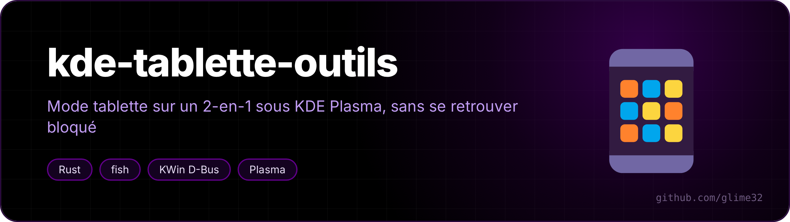
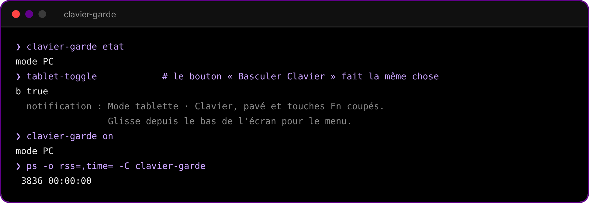

<p align="center"></p>

<p align="center">   </p>

<p align="center"><a href="README.md">🇬🇧 English version</a></p>

Un faux mode tablette pour un PC 2-en-1 sous KDE Plasma 6 (Wayland), fait pour mon Lenovo Yoga 7 2-in-1 14ILL10.

Sur ce modèle, le mode tablette de KDE ne s'active jamais quand on replie l'écran : le pilote `lenovo_ymc` voit bien l'interrupteur, mais l'Intel Sensor Hub n'a pas encore de firmware pour ce modèle dans linux-firmware, donc pas d'accéléromètre ni de bascule automatique. Je bascule donc à la main, avec un bouton dans la barre.

## Ce que fait le mode tablette

Un appui sur « Basculer Clavier » :

- coupe le clavier intégré, le pavé tactile et les touches Fn (avion, caméra, micro, luminosité…), pour que l'écran replié sur le clavier ne tape rien ;
- met le clavier virtuel de Plasma (`plasma-keyboard`) comme méthode de saisie, s'il est installé : il apparaît quand on touche un champ ;
- garde les bords de l'écran actifs même en plein écran : **glisser le doigt depuis le bas** ouvre le menu des applications (comme la touche Windows) et fait sortir du plein écran.

Un deuxième appui remet tout comme avant. Rien d'autre n'est jamais coupé : ni le bouton d'alimentation, ni le couvercle, ni l'écran tactile, ni le stylet, ni un clavier ou une souris branchés. Les périphériques sont choisis par leur nom exact, dans la constante `OFF` en haut de `clavier-garde/src/main.rs` (ce sont ceux de mon PC, à adapter, voir plus bas).

Deux filets de sécurité : à l'ouverture de session on repart en mode PC, et si on ferme puis rouvre le couvercle aussi. Je me suis déjà retrouvé coincé sans clavier ni pavé tactile, je ne voulais plus que ça arrive.

## Les pièces

| Fichier | Rôle |
|---|---|
| `clavier-garde/` | le démon, en Rust. Il dort tant qu'on ne lui parle pas : pas de minuteur, ~4 Mo de RAM, CPU à zéro. |
| `tablet-toggle` + `tablet-toggle.desktop` | le bouton « Basculer Clavier » : un seul appel D-Bus au démon (ou le démon lui-même s'il ne tourne pas). |
| `kwin/secours-tablette/` | script KWin du geste du bas. Il n'est posé que quand la barre n'est pas visible (cachée, ou sous une appli plein écran), parce que KWin avale les touchers qui commencent dans la zone du bord. |
| `panel-autohide.fish` | bascule la barre entre masquage automatique et toujours visible (Meta+H). |

L'interface D-Bus du démon, sur le bus de session :

```
org.glime.Tablette  /org/glime/Tablette
  Basculer() -> b        Tablette(b on) -> b        Etat() -> b      (b = mode tablette)
```

En ligne de commande : `clavier-garde basculer|on|off|etat` (`on` = clavier rallumé) ou `tablet-toggle [toggle|on|off|status]`.

<p align="center"></p>

## Installation

```bash
git clone https://github.com/glime32/kde-tablette-outils
cd kde-tablette-outils
./install.sh
```

Il faut Rust (`sudo pacman -S rust`) et fish pour `panel-autohide.fish`. Le script compile le démon, installe le bouton, le service utilisateur `clavier-garde.service` et le script KWin, et règle la zone de toucher des bords à 20 px (8 par défaut, trop fin pour un doigt). Ensuite, épingler « Basculer Clavier » dans la barre des tâches.

Pour le clavier à l'écran : `sudo pacman -S plasma-keyboard`.

Désinstaller : `./uninstall.sh` (rallume d'abord le clavier).

Pour trouver les noms de tes périphériques :

```bash
busctl --user get-property org.kde.KWin /org/kde/KWin/InputDevice org.kde.KWin.InputDeviceManager devicesSysNames
busctl --user get-property org.kde.KWin /org/kde/KWin/InputDevice/event3 org.kde.KWin.InputDevice name
```

## panel-autohide

`panel-autohide.fish toggle` bascule toutes les barres entre *masquage automatique* et *toujours visible*, et retient le choix. Le raccourci se règle dans *Paramètres → Clavier → Raccourcis → Ajouter une commande* → `~/.local/bin/toggle-panel-autohide.sh`. (L'écrire directement dans `kglobalshortcutsrc` ne marche qu'après une reconnexion.)

Avant le geste du bas, un service surveillait le clavier toutes les 2 s pour forcer la barre visible en mode tablette. Il ne sert plus : le mode tablette laisse la barre comme elle est, et `install` retire l'ancien service s'il le trouve.

## À savoir

- le clavier virtuel passe par la clé `InputMethod` du groupe `[Wayland]` de `kwinrc` ; l'ancienne valeur est gardée dans `~/.local/state/panel-autohide/methode-saisie-pc` et remise en mode PC ;
- `kwriteconfig6 --notify` suffit pour que KWin relise la méthode de saisie, pas besoin de redémarrer ;
- le bord d'une barre auto-masquée ne fait qu'1 px de haut côté KWin : impossible de la faire apparaître au doigt, d'où le geste ;
- les panneaux se pilotent avec `evaluateScript` sur `org.kde.PlasmaShell` (`panels()[i].hiding = "autohide" | "none"`).
