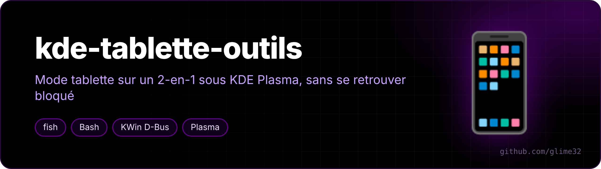
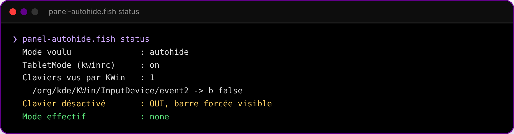

<p align="center"></p>

<p align="center">  </p>

<p align="center"><a href="README.fr.md">🇫🇷 Version française</a></p>

**Two small tools to use a 2-in-1 laptop in tablet mode on KDE Plasma 6 (Wayland)** without getting locked out — made for my Lenovo Yoga 7 2-in-1 14ILL10.

On this model KDE's tablet mode never triggers when you fold the screen: `lenovo_ymc` sees the switch, but the Intel Sensor Hub has no firmware for this model in linux-firmware yet, so there's no accelerometer. I handle it by hand.

## tablet-toggle

Turns the built-in keyboard and touchpad off/on in one go, through KWin's D-Bus interface (`org.kde.KWin.InputDevice.enabled`). No root needed.

```bash
./install.sh     # installs tablet-toggle + its launcher
```

Then pin "Basculer clavier" to the taskbar to get a touch button. `tablet-toggle on` forces the keyboard back.

Device names are those of my laptop; list yours with:

```bash
for p in $(busctl --user tree org.kde.KWin --list | grep InputDevice/event); do
  busctl --user get-property org.kde.KWin $p org.kde.KWin.InputDevice name
done
```

and put them in `TABLET_TOGGLE_DEVICES`, separated by `|`.

## panel-autohide

Toggles the taskbar between *auto-hide* and *always visible* (Meta+H + a button). A small service also watches the keyboard: as soon as it's disabled, the panel is forced visible. I added it after getting stuck with keyboard and touchpad off and a hidden panel.

<p align="center"><br><sub>keyboard disabled → panel forced visible</sub></p>

```bash
fish panel-autohide.fish install
```
